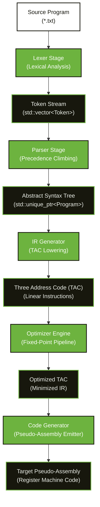
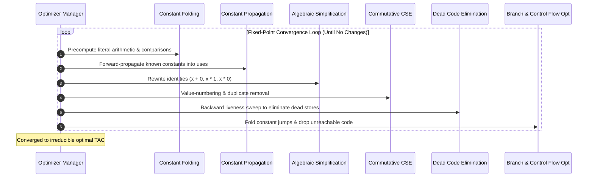

# ⚙️ MiniOpt — Mini Compiler & Code Optimizer

> A modular optimizing compiler for an imperative C-like language that lowers source code to **Three Address Code (TAC)**, executes an **iterative fixed-point optimization engine** (Constant Folding, Constant Propagation, Algebraic Simplification, Commutative CSE, and Backward Liveness DCE), and synthesizes **pseudo-assembly** for an abstract register machine.

<p align="center">
  
  
  
  
  
  
  
  
</p>

---

## Table of Contents

- [Why This Project Stands Out](#-why-this-project-stands-out)
- [Features at a Glance](#-features-at-a-glance)
- [Tech Stack](#-tech-stack)
- [Quick Start](#-quick-start)
- [Architecture Deep-Dive](#-architecture-deep-dive)
  - [Compiler Pipeline Architecture](#compiler-pipeline-architecture)
  - [Intermediate Representation (TAC) Design](#intermediate-representation-tac-design)
  - [Optimization Engine & Fixed-Point Convergence](#optimization-engine--fixed-point-convergence)
  - [Safety & Control-Flow Boundary Invalidation](#safety--control-flow-boundary-invalidation)
  - [Virtual Register & Backend Machine Model](#virtual-register--backend-machine-model)
- [Features & Optimizations in Detail](#-features--optimizations-in-detail)
- [Real Optimization Benchmarks](#-real-optimization-benchmarks)
- [Testing](#-testing)
- [Example CLI Walkthrough](#-example-cli-walkthrough)
- [Project Structure](#-project-structure)
- [Interview Discussion Guide (NVIDIA Focus)](#-interview-discussion-guide-nvidia-focus)
- [License](#-license)

---

## 🏆 Why This Project Stands Out

| Dimension | Architectural Implementation | Interview & Systems Value |
| :--- | :--- | :--- |
| **Zero Generator Dependencies** | Handcrafted Lexer and Recursive-Descent Parser with precedence climbing | Demonstrates foundational parsing algorithms without relying on Flex, Bison, or ANTLR black boxes. |
| **Decoupled Three-Address IR** | Explicit `OpCode`, `dest`, `src1`, `src2` linear quad instruction stream | Clean separation of frontend syntax from midend analysis; mirrors production compiler IR design. |
| **Fixed-Point Cascading Passes** | Multi-pass optimizer runs until mathematical convergence | Captures cross-pass synergies (e.g., Constant Propagation unlocking Algebraic Simplification and DCE). |
| **Commutative Value Numbering** | Canonical operand sorting in Common Subexpression Elimination (`x + y == y + x`) | Eliminates redundant ALU computations regardless of operand syntax order within basic blocks. |
| **Formal Backward Liveness** | Gen/Kill backward data-flow sweep for Dead Code Elimination | Prunes unused temporaries, unread user variables, and redundant stores in a single principled pass. |
| **CFG-Aware Optimization** | Conservative state invalidation across labels, jumps, and branch conditions | Guarantees transformation correctness across basic block boundaries and loop back-edges. |
| **Clean C++17 Idioms** | Strict RAII, smart pointer tree ownership (`std::unique_ptr`), const-correctness | Zero memory leaks, zero raw pointer arithmetic, and clean modern systems software design. |

---

## ✨ Features at a Glance

| Feature | Description |
| :--- | :--- |
| **Lexical Scanner** | Tokenizes identifiers, keywords (`int`, `if`, `while`), multi-char operators (`==`, `!=`, `<=`, `>=`), comments (`//`, `/* */`), with line/column diagnostic tracking. |
| **Recursive-Descent Parser** | Parses statements, assignments, conditionals, loops, and builds a strongly-typed AST with strict operator precedence climbing. |
| **AST Pretty-Printer** | Hierarchical formatted tree visualizer for syntax inspection. |
| **TAC Generation** | Lowers declarations, assignments, arithmetic, and branches into linearized Three Address Code with unique temporaries (`t1`, `t2`) and labels (`L1`, `L2`). |
| **Constant Folding** | Precomputes arithmetic and comparisons at compile time with zero-division runtime protection. |
| **Constant Propagation** | Propagates known constants into operand uses with forward invalidation on non-constant reassignments. |
| **Algebraic Simplification** | Rewrites identity and annihilation operations ($x+0 \to x$, $x-0 \to x$, $x \times 1 \to x$, $x \times 0 \to 0$, $x/1 \to x$). |
| **Common Subexpression Elimination** | Hash-based value numbering with operator commutativity support for reusable subexpression elimination. |
| **Dead Code Elimination** | Backward liveness analysis removing unread assignments, dead stores, and dead compiler temporaries. |
| **Branch Simplification** | Folds constant branch conditions (`if_false 1`, `if_false 0`), removes unreachable code, and eliminates redundant jumps. |
| **Pseudo-Assembly Emitter** | Synthesizes clean dual-register pseudo-assembly (`LOAD`, `STORE`, `ADD`, `SUB`, `MUL`, `DIV`, `CMP`, `JMP`, `JMP_IF_FALSE`). |
| **CLI & Benchmark Suite** | Rich command-line interface with stage inspection flags (`--tokens`, `--ast`, `--ir`, `--optimized-ir`, `--assembly`, `--benchmark`). |

---

## 🛠 Tech Stack

### Compiler Implementation

| Technology | Why |
| :--- | :--- |
| **C++17** | Modern standard offering `std::unique_ptr`, structured bindings, `std::string_view` concepts, and deterministic memory management. |
| **CMake 3.12+** | Industry standard, cross-platform build system for Windows (MSVC/MinGW) and Linux (GCC/Clang). |
| **Standard C++ Library** | Zero external dependencies (`<vector>`, `<unordered_map>`, `<memory>`, `<iostream>`, `<sstream>`). |
| **POSIX / Win32 Support** | Clean standard compliance guaranteeing identical behavior across developer environments. |

---

## 🚀 Quick Start

### Prerequisites

- **C++17 Compiler** (GCC $\ge$ 7, Clang $\ge$ 5, or MSVC $\ge$ 2017)
- **CMake** $\ge$ 3.12 *(optional; direct compiler commands also provided below)*

### 1. Clone the repository

```bash
git clone https://github.com/DestinyDriver/MiniOpt.git
cd MiniOpt
```

### 2. Build with CMake

```bash
mkdir build
cd build
cmake ..
cmake --build .
```

### 3. Run the compiler

```bash
# Run complete end-to-end pipeline on an example program
./miniopt ../examples/basic.txt
```

### 4. Direct Compilation (No CMake required)

```bash
# Compile miniopt directly with GCC / Clang
g++ -std=c++17 -Iinclude src/main.cpp src/lexer/*.cpp src/parser/*.cpp src/ir/*.cpp src/optimizer/*.cpp src/codegen/*.cpp -o miniopt

# Run compiler
./miniopt examples/basic.txt
```

---

## 🏛 Architecture Deep-Dive

### Compiler Pipeline Architecture

Each phase strictly communicates with the stage directly beneath it. The internal AST and TAC models insulate frontend syntax parsing from optimization passes and target machine code generation.



---

### Intermediate Representation (TAC) Design

The intermediate representation utilizes a normalized **quadruple structure**:

$$\text{Instruction} = \langle \text{OpCode}, \text{dest}, \text{src1}, \text{src2} \rangle$$

```cpp
struct TACInstruction {
    OpCode op;          // ADD, SUB, MUL, DIV, MOD, MOV, CMP, JUMP, JUMP_IF_FALSE, LABEL
    std::string dest;   // Target temporary, variable, or label name
    std::string src1;   // Primary operand or condition
    std::string src2;   // Secondary operand (if binary)
};
```

#### Why Linear Three Address Code?
- **Operand Minimization**: Every instruction performs at most one fundamental operation.
- **Explicit Temporary Generation**: Complex syntax trees are linearized into sequential temporary definitions (`t1 = b * 2`, `t2 = a + t1`), making def-use relationships immediate and transparent.
- **Machine Independence**: Neutral with respect to register count, calling conventions, and architecture-specific flags.

---

### Optimization Engine & Fixed-Point Convergence



---

### Safety & Control-Flow Boundary Invalidation

A critical challenge in optimizing compilers is preserving semantics across branching and looping constructs:

1. **Local Forward Maps Invalidation**: Constant Propagation and CSE maintain forward symbol and expression caches. When encountering a `LABEL`, `JUMP`, or `JUMP_IF_FALSE`, all forward assumptions are immediately invalidated.
2. **Loop Back-Edge Protection**: Because variables modified inside loop bodies (`while (x < 10) { x = x + 1; }`) have differing values between iterations, clearing the constant map at loop headers guarantees that loop induction variables are never incorrectly folded.
3. **Conservative Liveness Roots**: Dead Code Elimination treats all branch conditions, loop targets, and final observable variables as non-killable roots.

---

### Virtual Register & Backend Machine Model

The code generator targets a dual-register load-store architecture:
- **`R1`**: Primary accumulator and target of ALU results.
- **`R2`**: Secondary operand register.
- **Memory/Variables**: All local variables and compiler temporaries reside in symbolic memory cells accessed via `LOAD` and `STORE`.

```text
TAC:   t1 = a + b
ASM:   LOAD  R1, a
       LOAD  R2, b
       ADD   R1, R2
       STORE t1, R1
```

---

## 🔬 Features & Optimizations in Detail

### 1. Constant Folding
Precomputes operations on literals during compilation:
```text
# Before
t1 = 20 * 2
t2 = 10 + t1

# After Constant Folding
t1 = 40
t2 = 10 + t1
```
*Zero-division safeguard: `10 / 0` and `10 % 0` are never folded at compile time, guaranteeing faithful runtime semantics.*

### 2. Constant Propagation
Tracks variable-to-constant mappings and substitutes known literals into subsequent expressions:
```text
# Before
a = 10
b = a + 5
c = b * 2

# After Constant Propagation + Folding
a = 10
b = 15
c = 30
```

### 3. Algebraic Simplification
Eliminates redundant operations using algebraic identities:
- $x + 0 \to x$ and $0 + x \to x$
- $x - 0 \to x$ and $x - x \to 0$
- $x \times 1 \to x$ and $1 \times x \to x$
- $x \times 0 \to 0$ and $0 \times x \to 0$
- $x / 1 \to x$ and $x / x \to 1$ ($x \neq 0$)

### 4. Common Subexpression Elimination (CSE) with Commutativity
Maintains a hash map of available expressions. Commutative operations (`+`, `*`, `==`, `!=`) sort operands lexicographically before hashing so that $x + y$ and $y + x$ share the identical value number:
```text
# Before
t1 = x + y
a = t1
t2 = y + x    # Commutative duplicate
b = t2

# After CSE
t1 = x + y
a = t1
t2 = t1       # Reuses t1 without recomputing
b = t2
```

### 5. Dead Code Elimination (DCE)
Applies a backward liveness analysis to eliminate statements whose computed results are never read:
```text
# Before
a = 10
unused = 50
b = a + 5

# After DCE
a = 10
b = a + 5
```
*(The `unused = 50` assignment is completely removed).*

### 6. Control-Flow & Branch Optimization
- Folds `if_false 1 goto L` (never taken) into a simple fall-through.
- Transforms `if_false 0 goto L` (always taken) into an unconditional `goto L`.
- Discards unreachable code between unconditional jumps and the subsequent label.
- Eliminates redundant jumps immediately preceding their target label (`goto L1; L1:`).

---

## 📊 Real Optimization Benchmarks

The figures below are measured directly by running `miniopt --benchmark` against the suite in `examples/`:

| Benchmark | Description | Before (TAC) | After (TAC) | Instructions Removed | Code Reduction |
| :--- | :--- | :---: | :---: | :---: | :---: |
| [`basic.txt`](examples/basic.txt) | Chained arithmetic, identities, and copy assignments | 9 | 1 | 8 | **88.9%** |
| [`constant_folding.txt`](examples/constant_folding.txt) | Multi-stage arithmetic and precedence chains | 12 | 1 | 11 | **91.7%** |
| [`dead_code.txt`](examples/dead_code.txt) | Dead variables, unread computations, and dead stores | 9 | 1 | 8 | **88.9%** |
| [`complex.txt`](examples/complex.txt) | Commutative CSE, while-loops, branches & dead code | 25 | 11 | 14 | **56.0%** |

---

## 🧪 Testing

MiniOpt features a zero-dependency unit test suite covering every phase of the compiler.

```bash
# Run via CMake CTest
cd build && ctest --output-on-failure

# Or build and execute test suites directly
g++ -std=c++17 -Iinclude -Itests tests/lexer_tests.cpp src/lexer/*.cpp -o lexer_tests
./lexer_tests

g++ -std=c++17 -Iinclude -Itests tests/parser_tests.cpp src/lexer/*.cpp src/parser/*.cpp -o parser_tests
./parser_tests

g++ -std=c++17 -Iinclude -Itests tests/ir_tests.cpp src/lexer/*.cpp src/parser/*.cpp src/ir/*.cpp -o ir_tests
./ir_tests

g++ -std=c++17 -Iinclude -Itests tests/optimizer_tests.cpp src/lexer/*.cpp src/parser/*.cpp src/ir/*.cpp src/optimizer/*.cpp -o optimizer_tests
./optimizer_tests
```

### Test Coverage Highlights
- **Lexer**: Token type verification, multi-character operators, whitespace/comment stripping, and diagnostic column error throws.
- **Parser**: Operator precedence verification (`10 + 20 * 3`), parenthesized subexpressions, block scoping, and syntax error recovery.
- **IR Generator**: Semantic variable resolution, undefined variable exceptions, and branch/loop label generation.
- **Optimizer**: Multi-pass constant folding, algebraic reductions, commutative subexpression detection, backward liveness dead code pruning, and loop preservation.

---

## 📸 Example CLI Walkthrough

Executing `./miniopt examples/basic.txt` outputs the full pipeline transformation:

```text
========== SOURCE ==========
int a = 10;
int b = 20;
int c = a + b * 2;
int d = c + 0;
int e = d * 1;

========== TOKENS ==========
INT             int
IDENTIFIER      a
ASSIGN          =
NUMBER          10
...

========== AST ==========
Program
  VariableDeclaration: int a
    NumberExpr(10)
  VariableDeclaration: int b
    NumberExpr(20)
  VariableDeclaration: int c
    BinaryExpr (+)
      VariableExpr(a)
      BinaryExpr (*)
        VariableExpr(b)
        NumberExpr(2)
  ...

========== THREE ADDRESS CODE ==========
  a = 10
  b = 20
  t1 = b * 2
  t2 = a + t1
  c = t2
  t3 = c + 0
  d = t3
  t4 = d * 1
  e = t4

========== OPTIMIZATION ==========
Constant Folding:        ON
Constant Propagation:    ON
Algebraic Simplification: ON
CSE:                     ON
Dead Code Elimination:   ON

========== OPTIMIZED TAC ==========
  e = 50

========== PSEUDO ASSEMBLY ==========
    LOAD          R1, 50    # e = 50
    STORE         e, R1

========== STATISTICS ==========
Original instructions:  9
Optimized instructions: 1
Instructions removed:   8
Reduction:              88.89%
```

---

## 📁 Project Structure

```
MiniOpt/
├── CMakeLists.txt                 # Cross-platform CMake configuration
├── README.md                      # Primary project overview and guide
├── LICENSE                        # MIT License
│
├── include/                       # Public API header files
│   ├── lexer/
│   │   ├── Token.h                # TokenType enum & Token structure
│   │   └── Lexer.h                # Lexical scanner & LexerError
│   ├── parser/
│   │   ├── AST.h                  # Strongly-typed AST node hierarchy
│   │   └── Parser.h               # Recursive-descent parser & ParserError
│   ├── ir/
│   │   ├── TAC.h                  # Three Address Code quad representation
│   │   └── IRGenerator.h          # AST-to-TAC lowering & semantic analysis
│   ├── optimizer/
│   │   ├── ConstantFolding.h      # Compile-time arithmetic & comparison folder
│   │   ├── ConstantPropagation.h  # Forward-flow constant value propagator
│   │   ├── AlgebraicSimplification.h # Additive/multiplicative identity rewrites
│   │   ├── DeadCodeElimination.h  # Backward liveness & dead store analyzer
│   │   └── Optimizer.h            # Fixed-point pass manager & commutative CSE
│   └── codegen/
│       └── CodeGenerator.h        # Pseudo-assembly target code generator
│
├── src/                           # Component implementations
│   ├── main.cpp                   # CLI driver and benchmark suite
│   ├── lexer/                     # Lexer.cpp, Token.cpp
│   ├── parser/                    # Parser.cpp, AST.cpp
│   ├── ir/                        # IRGenerator.cpp, TAC.cpp
│   ├── optimizer/                 # Optimizer.cpp, passes
│   └── codegen/                   # CodeGenerator.cpp
│
├── tests/                         # Unit tests
│   ├── test_utils.h               # Zero-dependency test assertions
│   ├── lexer_tests.cpp            # Lexer unit tests
│   ├── parser_tests.cpp           # Parser & AST tests
│   ├── ir_tests.cpp               # TAC lowering & semantic tests
│   └── optimizer_tests.cpp        # Pass-by-pass optimizer tests
│
├── examples/                      # Benchmark and test programs
│   ├── basic.txt                  # Chained arithmetic and algebraic identities
│   ├── constant_folding.txt       # Deep arithmetic expressions
│   ├── dead_code.txt              # Dead stores and unused variables
│   └── complex.txt                # While-loops, branches, commutative CSE
│
└── docs/                          # In-depth technical guides
    ├── architecture.md            # Detailed architecture and compiler pipeline
    └── optimizations.md           # Algorithmic specifications for all passes
```

---

## 🎯 Interview Discussion Guide (NVIDIA Focus)

### 1. Linear Three Address Code vs. Static Single Assignment (SSA)
* **Interview Context**: Production compilers like LLVM, GCC, and NVIDIA NVVM/PTX utilize SSA form with $\phi$-nodes for global optimizations.
* **MiniOpt Design**: MiniOpt implements linearized Three Address Code with basic block boundary flushing. This enables direct, transparent explanations of def-use chains, value numbering, and backward liveness without the overhead of dominance frontier computation.

### 2. Ensuring Optimization Safety Across Control-Flow Branches
* **Interview Context**: Inlining or propagating values across basic block boundaries can introduce subtle bugs if a variable is redefined on another branch path.
* **MiniOpt Design**: MiniOpt clears all forward available-expression tables and constant maps at control-flow boundaries (`LABEL`, `JUMP`, `JUMP_IF_FALSE`). For Dead Code Elimination, all branch conditions and loop header labels are treated as non-killable roots, preventing loop induction variables from being pruned.

### 3. Transitioning to Target Machine Architectures (PTX / x86-64)
* **Interview Context**: How does an abstract pseudo-assembly backend map to physical hardware?
* **MiniOpt Extension Path**:
  1. **Instruction Selection**: Replace linear translation with maximal-munch tree pattern matching targeting instructions like PTX `add.s32` or x86 `add eax, edx`.
  2. **Register Allocation**: Transition the virtual 2-register model to Chaitin-Briggs Graph Coloring or Poletto-Sarkar Linear Scan register allocation to assign virtual temporaries to hardware registers and emit spill code (`STORE [RBP - offset], REG`) under high register pressure.

---

## 📄 License

This project is licensed under the MIT License — see the [LICENSE](LICENSE) file for details.
