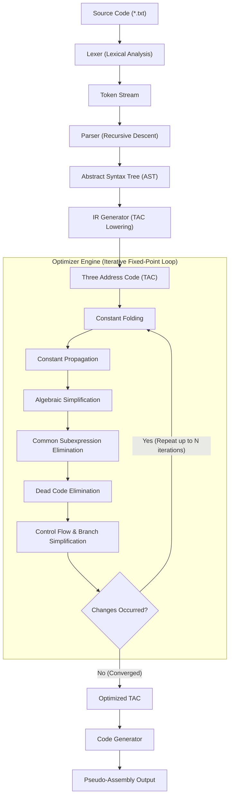

# MiniOpt — Mini Compiler & Code Optimizer

[](https://en.cppreference.com/w/cpp/17)
[](https://cmake.org/)
[](LICENSE)

**MiniOpt** is a moderate-level optimizing compiler implemented from scratch in modern **C++17**. It translates an imperative C-like language into Three Address Code (TAC), executes an iterative optimization pipeline over control-flow aware basic blocks, and synthesizes pseudo-assembly for an abstract load-store register machine.

It was engineered specifically to demonstrate clean compiler system design for **NVIDIA System Software / Compiler Engineering** technical interviews.

---

## Table of Contents

- [1. Motivation & Goals](#1-motivation--goals)
- [2. Supported Language](#2-supported-language)
- [3. Compiler Architecture](#3-compiler-architecture)
- [4. Lexical Analysis (Lexer)](#4-lexical-analysis-lexer)
- [5. Parser & Abstract Syntax Tree (AST)](#5-parser--abstract-syntax-tree-ast)
- [6. Intermediate Representation (Three Address Code)](#6-intermediate-representation-three-address-code)
- [7. Optimization Passes](#7-optimization-passes)
- [8. Code Generation (Pseudo-Assembly)](#8-code-generation-pseudo-assembly)
- [9. Real Optimization Benchmarks](#9-real-optimization-benchmarks)
- [10. Command-Line Interface (CLI)](#10-command-line-interface-cli)
- [11. Build & Test Instructions](#11-build--test-instructions)
- [12. Limitations & Future Work](#12-limitations--future-work)
- [13. Interview Discussion Points](#13-interview-discussion-points)

---

## 1. Motivation & Goals

Industrial compilers like LLVM, GCC, and NVIDIA NVVM/PTX are vast codebases exceeding millions of lines of code. **MiniOpt** isolates the core theoretical and practical concepts of optimizing compilers into a compact, self-contained, and fully explainable C++ project:

- **No external parser/lexer generators**: Handcrafted Lexer and recursive-descent Parser.
- **Linearized Three Address Code (TAC)**: Clean intermediate representation with temporary variable management and control-flow jumps.
- **Iterative Fixed-Point Optimization Engine**: Constant Folding, Constant Propagation, Algebraic Simplification, Common Subexpression Elimination (CSE), Dead Code Elimination (DCE), and Branch Optimization.
- **Modern C++17 Standards**: Zero raw pointer management, strict RAII, const-correctness, and zero third-party dependencies outside the C++ standard library.

---

## 2. Supported Language

MiniOpt supports an imperative C-like subset:

- **Data Types**: `int` (32-bit signed integers).
- **Statements**:
  - Declarations: `int x = <expr>;`
  - Assignments: `x = <expr>;`
- **Arithmetic Operators**: `+`, `-`, `*`, `/`, `%`
- **Parentheses**: `(a + b) * c`
- **Comparison Operators**: `<`, `>`, `<=`, `>=`, `==`, `!=`
- **Control Flow**:
  - `if (condition) { ... }`
  - `while (condition) { ... }`
- **Comments**:
  - Line comments: `// ...`
  - Block comments: `/* ... */`

Example program:

```cpp
int x = 10;
int y = 20;
int dead1 = 999;
int a = x + y;
int b = y + x;
int c = a * 1;
int d = b + 0;
int dead2 = dead1 + 1;
int e = c + d;
int i = 0;
while (i < 5) {
    i = i + 1;
    e = e + i;
}
```

---

## 3. Compiler Architecture



For full architecture details, see [`docs/architecture.md`](docs/architecture.md).

---

## 4. Lexical Analysis (Lexer)

The Lexer scans the raw text input and produces a stream of strongly-typed `Token` objects, with line and column numbers tracked for compiler diagnostics.

```text
int x = 10 + 20;
```
Yields:
```text
INT          int
IDENTIFIER   x
ASSIGN       =
NUMBER       10
PLUS         +
NUMBER       20
SEMICOLON    ;
```

Invalid characters trigger informative error messages:
```text
Lexer Error at line 4, column 12: Unexpected character '@'
```

---

## 5. Parser & Abstract Syntax Tree (AST)

The Parser implements **recursive-descent parsing** with strict operator precedence:

$$\text{Parentheses} > \text{Multiplicative } (*, /, \%) > \text{Additive } (+, -) > \text{Comparisons } (<, >, \le, \ge, ==, \ne) > \text{Assignments } (=)$$

For the statement `int x = 10 + 20 * 2;`, MiniOpt constructs and pretty-prints:
```text
Program
  VariableDeclaration: int x
    BinaryExpr (+)
      NumberExpr(10)
      BinaryExpr (*)
        NumberExpr(20)
        NumberExpr(2)
```

---

## 6. Intermediate Representation (Three Address Code)

AST statements and expressions are lowered into linear **Three Address Code (TAC)**. Each instruction contains:
- `op`: Operation opcode
- `dest`: Target destination
- `src1`: First operand
- `src2`: Second operand (optional)

Example TAC lowering:
```text
t1 = 20 * 2
t2 = 10 + t1
x = t2
```

Control flow is represented using conditional branches (`if_false cond goto Label`), unconditional jumps (`goto Label`), and destination labels (`Label:`):
```text
L1:
  t1 = i < 10
  if_false t1 goto L2
  t2 = i + 1
  i = t2
  goto L1
L2:
```

---

## 7. Optimization Passes

MiniOpt provides six core optimization passes (detailed in [`docs/optimizations.md`](docs/optimizations.md)):

1. **Constant Folding**: Evaluates constant operations at compile time (`10 + 20 * 3` $\to$ `70`). Includes zero-division guards.
2. **Constant Propagation**: Forward-propagates known variable values and invalidates mappings upon non-constant reassignment.
3. **Algebraic Simplification**: Applies identities ($x + 0 \to x$, $x \times 1 \to x$, $x \times 0 \to 0$, $x / 1 \to x$).
4. **Common Subexpression Elimination (CSE)**: Caches computed expressions within basic blocks and normalizes commutative operators ($x + y \equiv y + x$).
5. **Dead Code Elimination (DCE)**: Backward liveness analysis removing unread assignments, dead stores, and unused temporaries.
6. **Control Flow Optimization**: Folds constant branches (`if_false 1`, `if_false 0`), prunes unreachable blocks, and drops redundant jumps.

---

## 8. Code Generation (Pseudo-Assembly)

The backend lowers optimized TAC to pseudo-assembly for an abstract dual-register load-store architecture:

```text
t1 = a + b
```
Translates to:
```text
    LOAD          R1, a
    LOAD          R2, b
    ADD           R1, R2
    STORE         t1, R1
```

Supported pseudo-instructions:
`LOAD`, `STORE`, `ADD`, `SUB`, `MUL`, `DIV`, `MOD`, `CMP`, `JMP`, `JMP_IF_FALSE`, `LABEL`.

---

## 9. Real Optimization Benchmarks

The benchmark results below are measured directly using `miniopt --benchmark`:

| Benchmark | Description | Before (TAC) | After (TAC) | Instructions Removed | Reduction |
| :--- | :--- | :---: | :---: | :---: | :---: |
| `basic.txt` | Chained arithmetic and identities | 9 | 1 | 8 | **88.9%** |
| `constant_folding.txt` | Deep constant expressions | 12 | 1 | 11 | **91.7%** |
| `dead_code.txt` | Unused variables & dead stores | 9 | 1 | 8 | **88.9%** |
| `complex.txt` | Loops, CSE, dead code & control flow | 25 | 11 | 14 | **56.0%** |

---

## 10. Command-Line Interface (CLI)

### Full Pipeline Run (Default)
```bash
./miniopt examples/basic.txt
```

Outputs:
```text
========== SOURCE ==========
int a = 10;
int b = 20;
int c = a + b * 2;
int d = c + 0;
int e = d * 1;

========== TOKENS ==========
INT             int
IDENTIFIER      a
ASSIGN          =
NUMBER          10
...

========== AST ==========
Program
  VariableDeclaration: int a
    NumberExpr(10)
  ...

========== THREE ADDRESS CODE ==========
  a = 10
  b = 20
  t1 = b * 2
  t2 = a + t1
  c = t2
  t3 = c + 0
  d = t3
  t4 = d * 1
  e = t4

========== OPTIMIZATION ==========
Constant Folding:        ON
Constant Propagation:    ON
Algebraic Simplification: ON
CSE:                     ON
Dead Code Elimination:   ON

========== OPTIMIZED TAC ==========
  e = 50

========== PSEUDO ASSEMBLY ==========
    LOAD          R1, 50    # e = 50
    STORE         e, R1

========== STATISTICS ==========
Original instructions:  9
Optimized instructions: 1
Instructions removed:   8
Reduction:              88.89%
```

### Stage Inspection & Flags
```bash
# Individual stage inspection
./miniopt examples/complex.txt --tokens
./miniopt examples/complex.txt --ast
./miniopt examples/complex.txt --ir
./miniopt examples/complex.txt --optimized-ir
./miniopt examples/complex.txt --assembly

# Toggle individual optimization passes
./miniopt examples/basic.txt --no-dce
./miniopt examples/basic.txt --no-cse
./miniopt examples/basic.txt --no-const-fold
./miniopt examples/basic.txt --no-const-prop
./miniopt examples/basic.txt --no-algebraic

# Run the benchmark suite
./miniopt --benchmark
```

---

## 11. Build & Test Instructions

### Option A: Building with CMake
```bash
mkdir build
cd build
cmake ..
cmake --build .
```

Run test suite:
```bash
ctest --output-on-failure
```

### Option B: Direct Compilation with any C++17 Compiler (GCC / Clang / MSVC)

```bash
# Build miniopt executable
g++ -std=c++17 -Iinclude src/main.cpp src/lexer/*.cpp src/parser/*.cpp src/ir/*.cpp src/optimizer/*.cpp src/codegen/*.cpp -o miniopt

# Build and run unit tests
g++ -std=c++17 -Iinclude -Itests tests/lexer_tests.cpp src/lexer/*.cpp -o lexer_tests
./lexer_tests

g++ -std=c++17 -Iinclude -Itests tests/parser_tests.cpp src/lexer/*.cpp src/parser/*.cpp -o parser_tests
./parser_tests

g++ -std=c++17 -Iinclude -Itests tests/ir_tests.cpp src/lexer/*.cpp src/parser/*.cpp src/ir/*.cpp -o ir_tests
./ir_tests

g++ -std=c++17 -Iinclude -Itests tests/optimizer_tests.cpp src/lexer/*.cpp src/parser/*.cpp src/ir/*.cpp src/optimizer/*.cpp -o optimizer_tests
./optimizer_tests
```

---

## 12. Limitations & Future Work

While MiniOpt covers the end-to-end compiler lifecycle, intentional design constraints keep it focused:

1. **Static Single Assignment (SSA) Form**: MiniOpt utilizes linearized Three Address Code with basic block boundary flushing. Transforming TAC to SSA with $\phi$-nodes would allow global data-flow analysis (GVN, global dead code elimination).
2. **Register Allocation**: The backend uses an abstract 2-register accumulator model. A production backend would implement **Chaitin-Briggs Graph Coloring** or **Poletto-Sarkar Linear Scan** register allocation with memory spill handling.
3. **Machine Code Emission**: MiniOpt emits human-readable pseudo-assembly. Future extensions could emit x86-64 NASM or NVIDIA PTX (Parallel Thread Execution) assembly.

---

## 13. Interview Discussion Points

Topics directly relevant to an **NVIDIA Compiler / System Software** interview:

- **Frontend Separation**: How recursive-descent parsing with precedence climbing avoids ambiguity without generating bloated parser tables.
- **TAC vs. AST Optimization**: Why midend optimizations operate on linearized Three Address Code rather than directly on syntax tree nodes.
- **Safety Invariants**: How constant propagation and CSE prevent unsound transformations across loop back-edges and branch targets by clearing local state.
- **Pass Ordering & Fixed-Point Convergence**: Why optimizations run in an iterative loop and how certain transformations expose opportunities for subsequent passes.
- **Liveness Analysis**: How backward liveness tracking automatically achieves both dead variable pruning and dead store elimination.

---

## License

MIT License. See [LICENSE](LICENSE) for details.
