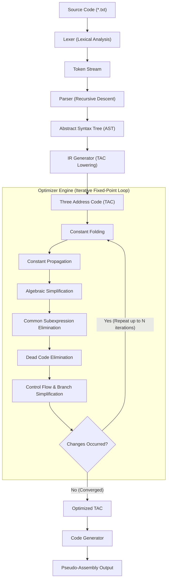

# MiniOpt Compiler Architecture

## 1. Overview and Design Philosophy

**MiniOpt** is an educational, moderate-level optimizing compiler designed to illustrate end-to-end compiler engineering principles. It transforms a C-like imperative language into a Three-Address Code (TAC) intermediate representation, applies a sequence of classical compiler optimizations over control-flow aware basic blocks, and synthesizes pseudo-assembly targeting an abstract load-store register machine.

The architecture emphasizes:
- **Clean Separation of Concerns**: Strict boundary between frontend (lexing, parsing, AST), midend (TAC generation, control flow, optimization passes), and backend (code generation).
- **Modern C++ Idioms**: Strict RAII, smart pointer ownership (`std::unique_ptr` for AST hierarchies), const-correctness, zero raw pointer leakage, and standard library data structures.
- **Explainability**: Architected specifically to demonstrate mastery of compiler systems concepts relevant to system software and compiler interviews (such as NVIDIA Compiler & System Software teams).

---

## 2. End-to-End Compiler Pipeline

---

## 3. Pipeline Stages in Detail

### 3.1 Lexical Analysis (`include/lexer/`, `src/lexer/`)
- **Purpose**: Converts an input character stream into a sequence of strongly-typed tokens (`Token`), tracking line and column metadata for error diagnostics.
- **Implementation**: Handcrafted state machine (`Lexer::scanToken`).
- **Features**:
  - Distinguishes keywords (`int`, `if`, `while`) from arbitrary identifiers using an exact-match hash table.
  - Multi-character operator resolution with single-character lookahead (`==`, `!=`, `<=`, `>=`).
  - Strips single-line comments (`// ...`) and block comments (`/* ... */`).
  - Throws descriptive `LexerError` exceptions containing 1-indexed line and column numbers.

### 3.2 Parsing and Abstract Syntax Tree (`include/parser/`, `src/parser/`)
- **Purpose**: Validates grammar and constructs a high-level hierarchical AST.
- **Technique**: Recursive-descent parser with precedence climbing.
- **Precedence Hierarchy** (from lowest to highest):
  1. Statements / Assignments (`=`)
  2. Comparison Operators (`<`, `>`, `<=`, `>=`, `==`, `!=`)
  3. Additive Operators (`+`, `-`)
  4. Multiplicative Operators (`*`, `/`, `%`)
  5. Unary Operators (`+`, `-`)
  6. Primary Expressions (Literals, Identifiers, Parenthesized subexpressions `(...)`)
- **Node Hierarchy**:
  - `ASTNode` (base)
    - `Statement`: `VariableDeclaration`, `Assignment`, `IfStatement`, `WhileStatement`, `BlockStatement`
    - `Expression`: `NumberExpr`, `VariableExpr`, `BinaryExpr`
  - `Program`: Root sequence of statements.

### 3.3 Intermediate Representation (`include/ir/`, `src/ir/`)
- **Purpose**: De-couples high-level syntax from target machine details using **Three Address Code (TAC)**.
- **Instruction Structure**:
  - `OpCode`: ALU operations (`ADD`, `SUB`, `MUL`, `DIV`, `MOD`), memory transfer (`MOV`), comparisons (`CMP_LT`, `CMP_GT`, etc.), control jumps (`JUMP`, `JUMP_IF_FALSE`), and branch targets (`LABEL`).
  - `dest`: Target register/temporary or label.
  - `src1`, `src2`: Source operands (variables, temporaries, or integer literals).
- **Lowering Strategy**:
  - Complex nested expressions are linearized into temporary variables (`t1`, `t2`, ...).
  - High-level control flow (`if`, `while`) is lowered into conditional branches (`if_false cond goto Label`), unconditional branches (`goto Label`), and destination labels (`Label:`).

### 3.4 Optimization Framework (`include/optimizer/`, `src/optimizer/`)
- **Design**: An iterative pass manager driving modular optimization transformations until convergence (fixed point):
  1. **Constant Folding**: Precomputes compile-time constant arithmetic.
  2. **Constant Propagation**: Propagates known constants into operand uses.
  3. **Algebraic Simplification**: Applies mathematical identities ($x+0=x$, $x\times 0=0$, etc.).
  4. **Common Subexpression Elimination (CSE)**: Detects repeated computations, exploiting operator commutativity ($x+y \equiv y+x$).
  5. **Dead Code Elimination (DCE)**: Backward liveness analysis removing unused stores and dead temporaries.
  6. **Control Flow Optimization**: Prunes constant jumps and eliminates unreachable code blocks.
- **Safety**: Passes respect basic block boundaries; local forward state is cleared across labels and jumps.

### 3.5 Code Generation (`include/codegen/`, `src/codegen/`)
- **Purpose**: Translates optimized TAC instructions into a clean pseudo-assembly representation targeting an abstract load-store architecture.
- **Virtual Register Model**:
  - `R1`: Primary accumulator / first ALU operand.
  - `R2`: Secondary operand register.
- **Instruction Set**:
  - Memory: `LOAD R, operand`, `STORE memory, R`
  - ALU: `ADD R1, R2`, `SUB R1, R2`, `MUL R1, R2`, `DIV R1, R2`, `MOD R1, R2`
  - Comparison: `CMP R1, R2`
  - Control Flow: `JMP label`, `JMP_IF_FALSE R1, label`, `LABEL label:`

---

## 4. Technical Interview Discussion Guide (NVIDIA Focus)

### Q: Why Three Address Code (TAC) instead of SSA form?
*Response*: TAC represents a universal linearization format where every instruction has at most one operator and at most three addresses. It is simple to construct, inspect, and optimize for basic blocks. In production compilers like LLVM or NVIDIA's NVVM/PTX, Static Single Assignment (SSA) form with $\phi$-nodes is preferred for global data-flow optimizations. However, TAC mirrors the quad/triple representation taught in compiler foundations and provides an optimal balance between clarity and optimization power for an educational project.

### Q: How does MiniOpt handle safety in optimizations across control flow?
*Response*: Optimizations like Constant Propagation and CSE maintain forward available-expression tables. In MiniOpt, encountering a control-flow delimiter (`LABEL`, `JUMP`, `JUMP_IF_FALSE`) triggers conservative invalidation of local forward assumptions. This guarantees that values redefined across conditional paths or loops are never erroneously assumed constant or reused.

### Q: How would you extend the Pseudo-Assembly backend to a real ISA like NVIDIA PTX or x86-64?
*Response*:
1. **Register Allocation**: Replace the naive 2-register virtual accumulator with a Graph Coloring (Chaitin-Briggs) or Linear Scan Register Allocator, assigning virtual temporaries to physical hardware registers and emitting spill code (`STORE [RBP - offset], REG`) when register pressure exceeds physical limits.
2. **Instruction Selection**: Use tree-rewriting / maximal munch or tablegen-driven pattern matching to map TAC operations directly to target ISA instructions (e.g., PTX `add.s32`, `mul.lo.s32`, `setp.lt.s32`).
3. **Pipelining / Instruction Scheduling**: Reorder instructions to minimize latency stalls and exploit hardware pipelining or warp execution models.
